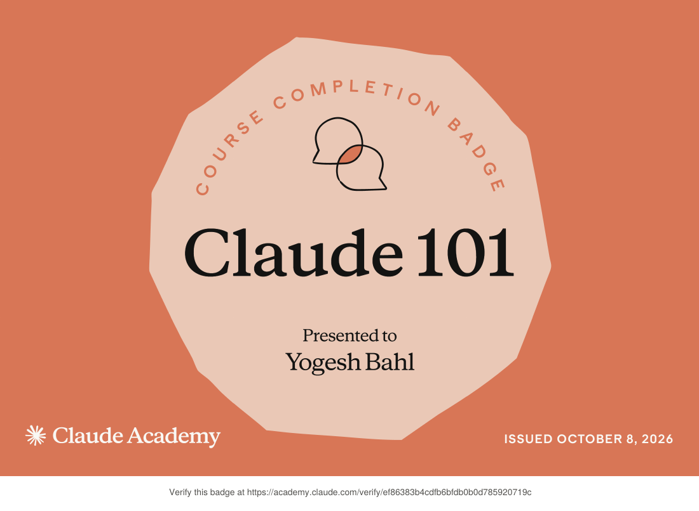
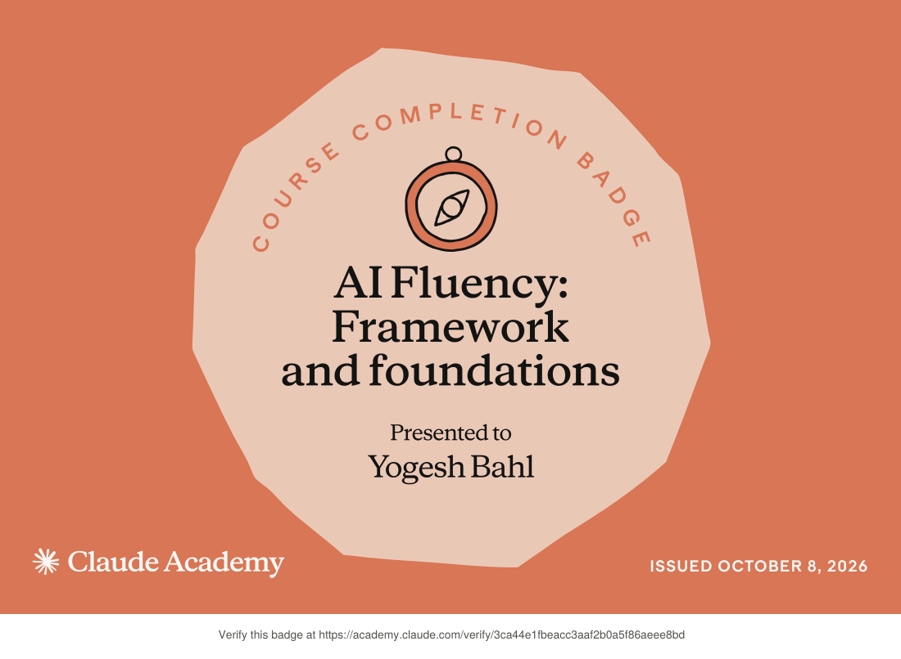
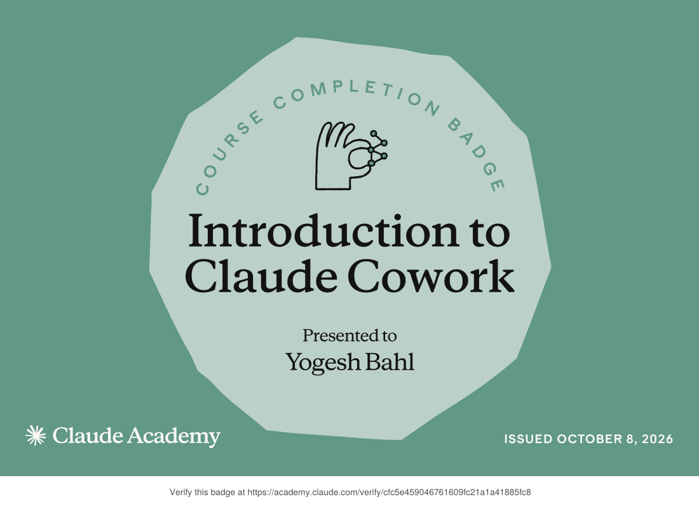
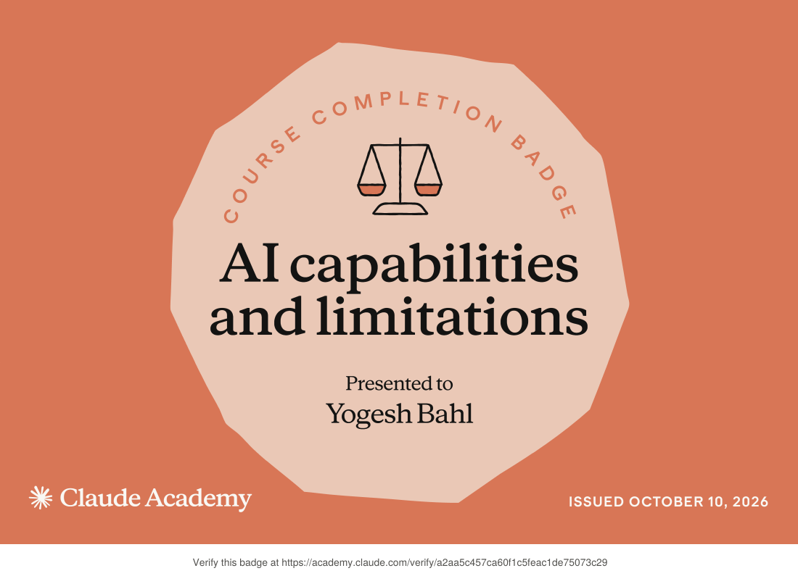

## Hi, I'm Yogesh 👋
Completed AI/ML Engineering | Generative AI Specialization, and data-driven solutions — forecasting, NLP, and predictive models.

## 🏅 Certifications

**Claude Academy (Anthropic)**: course completion badges. Click any badge to verify it.

<table>
  <tr>
    <td align="center" width="50%">
       
      <b>Claude 101</b> 
      Issued Oct 8, 2026 · <a href="https://academy.claude.com/verify/ef86383b4cdfb6bfdb0b0d785920719c">Verify</a> · <a href="certificates/claude-101.pdf">PDF</a>
    </td>
    <td align="center" width="50%">
       
      <b>AI Fluency: Framework and Foundations</b> 
      Issued Oct 8, 2026 · <a href="https://academy.claude.com/verify/3ca44e1fbeacc3aaf2b0a5f86aeee8bd">Verify</a> · <a href="certificates/ai-fluency-framework-foundations.pdf">PDF</a>
    </td>
  </tr>
  <tr>
    <td align="center" width="50%">
       
      <b>Introduction to Claude Cowork</b> 
      Issued Oct 8, 2026 · <a href="https://academy.claude.com/verify/cfc5e459046761609fc21a1a41885fc8">Verify</a> · <a href="certificates/introduction-to-claude-cowork.pdf">PDF</a>
    </td>
    <td align="center" width="50%">
       
      <b>AI Capabilities and Limitations</b> 
      Issued Oct 10, 2026 · <a href="https://academy.claude.com/verify/a2aa5c457ca60f1c5feac1de75073c29">Verify</a> · <a href="certificates/ai-capabilities-and-limitations.pdf">PDF</a>
    </td>
  </tr>
</table>

## 🤖 What I Build
Local + cloud LLM applications
Search & RAG Systems
Hybrid search architectures (embeddings + BM25)
ChromaDB vector databases & semantic search
Document intelligence and knowledge retrieval

## RAG pipelines & document Q&A
Analytics dashboards & data apps
Fine-Tuning & Model Optimization
Streamlit for rapid prototyping & dashboards

# 👨‍💼 About Me
Background

# 🛠️ Tech Stack
# Languages & Frameworks
  Python, JavaScript, SQL
  LangChain, LangGraph, OpenAI API
  PyTorch, Scikit-Learn

# LLM & AI Tools
Multi-agent systems & orchestration
Vector databases (ChromaDB, Pinecone, Weaviate)
Embedding models & semantic search
Fine-tuning & prompt engineering

# Data & ML Ops
Weights & Biases, MLflow
PyTorch Lightning, Hugging Face
Pandas, NumPy, Scikit-Learn
Streamlit

Databases & Infrastructure
Docker & containerization
Cloud platforms (AWS)
